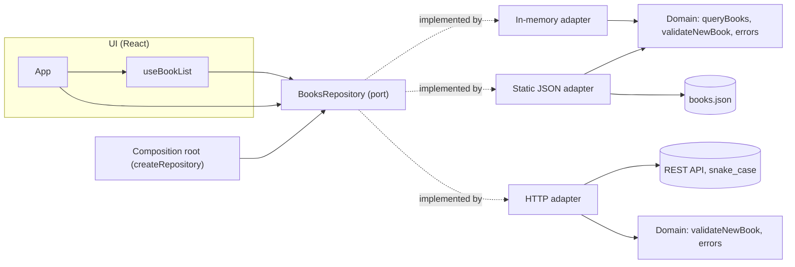

# Ports and adapters (hexagonal architecture) in React


One React UI, three interchangeable data sources, and **one contract test suite** that proves they behave the same. The UI depends on a `BooksRepository` *port*; *adapters* implement it for an in-memory array, a static JSON file, and a REST API with a different data format. Which adapter is used is decided in one place, at startup.

This is the path many front ends take in real life: start on static data, then move to a real backend, without rewriting the UI.


## What it demonstrates

- **Dependency inversion:** components import the port (through React context), never an adapter.
- **A composition root:** `src/app/createRepository.js` is the only file that knows which adapter runs.
- **An anti-corruption layer:** the REST API uses `book_title`, `author_name`, one-based pages and `{ data, meta }` envelopes; the HTTP adapter translates all of it, including validation errors, into the domain’s own names.
- **Contract tests:** the same 7 tests run against all three adapters. An adapter that passes can be swapped in without touching the UI.
- **Capabilities, not failures:** the static adapter is read-only and says so (`capabilities.canCreate: false`), so the UI hides the form instead of letting a submit fail.
- **Domain errors:** `NotFoundError`, `ValidationError`, `UnsupportedError` and `UnavailableError` mean the same thing whichever adapter raised them.
- **Fail-fast wiring:** `assertBooksRepository` rejects an incomplete adapter at startup.

## Quick start

Requires Node 20+.

```bash
npm install
npm test            # 23 tests: the contract × 3 adapters, plus conformance checks

npm run dev         # UI on static JSON (read-only)
npm run dev:memory  # UI on the in-memory adapter

npm run mock-api    # terminal 1: REST API on http://localhost:8081
npm run dev:http    # terminal 2: UI on the REST adapter
```

With the REST adapter, try adding a book called “Dracula”. Only the server checks for duplicate titles, and its error still appears under the Title field, translated from `book_title` by the adapter.

## Architecture



Patterns, decisions and alternatives: **[docs/ARCHITECTURE.md](docs/ARCHITECTURE.md)**.

## Files

| Path | Role |
| --- | --- |
| `src/domain/` | `Book` validation, query rules, domain errors (no I/O, no React) |
| `src/ports/BooksRepository.js` | The port: JSDoc interface plus a runtime conformance check |
| `src/adapters/` | `inMemory.js`, `staticJson.js`, `http.js` |
| `src/app/createRepository.js` | Composition root, chosen by `VITE_DATA_SOURCE` |
| `src/ui/` | React components; they only see the port |
| `mock-api/server.mjs` | A REST API with deliberately different conventions |
| `test/contract.test.mjs` | The shared contract and the conformance tests |

## Limitations

- The port covers list, get and create; update and delete would follow the same pattern.
- The static and in-memory adapters query in the browser, which suits small datasets only.
- There’s no caching layer; it would sit in front of the port, not inside an adapter.

## How this was built

Built through AI pair programming with Claude (Anthropic). I defined the requirements and reviewed and tested the result; Claude wrote most of the code.

## License

MIT. The book list contains public-domain titles.
