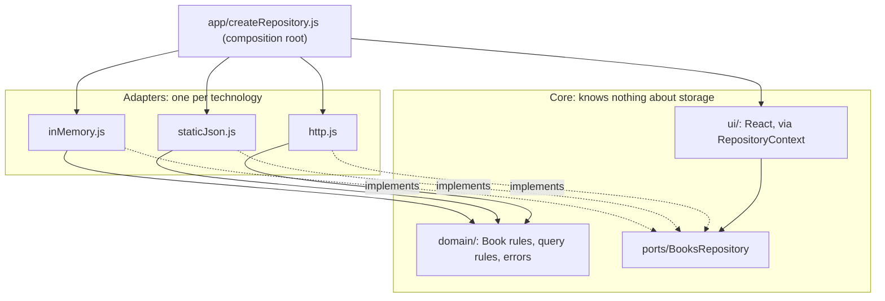

# Architecture

## The idea

The application core (domain rules and the UI) defines what it needs from storage as a **port**. Each storage technology gets an **adapter** that implements the port. Dependencies point inward: adapters know about the domain; the domain and UI know nothing about adapters.

## Design patterns

| Pattern | Where | Problem it solves |
| --- | --- | --- |
| **Ports and adapters (hexagonal)** | `ports/`, `adapters/` | Storage can change without touching domain rules or UI |
| **Repository** | `BooksRepository` | A collection-like interface (`list`, `get`, `create`) instead of storage calls |
| **Dependency inversion** | UI → port ← adapters | High-level code doesn’t depend on low-level details |
| **Composition root** | `createRepository.js` | One place decides the wiring; everything else receives it |
| **Dependency injection via context** | `RepositoryProvider` / `useRepository` | Components get the repository without importing it, and tests can provide any adapter |
| **Anti-corruption layer** | `http.js` (`toDomain`, `toDto`, `FIELD_TO_DOMAIN`) | The API’s naming and paging never leak into the app |
| **Capability flags** | `capabilities.canCreate` | The UI adapts to what a source supports instead of failing |
| **Domain error types** | `domain/errors.js` | Callers handle “not found” or “invalid” the same way whatever the source |
| **Contract tests** | `test/contract.test.mjs` | Proof that every adapter honours the same behaviour, including ordering and paging |
| **Fail fast** | `assertBooksRepository` | A missing method breaks at startup, not on the first click |

## Key decisions

**Validation lives in the domain and runs in every adapter.** The HTTP adapter validates before sending, so users get instant feedback, and still translates the server’s own errors, because servers have rules clients can’t check (unique titles here).

**Query rules are domain code shared by the local adapters.** In-memory and static JSON use `queryBooks`; the REST API implements its own. The contract tests are what keep the two implementations in agreement: same search, same order, same paging.

**The port is a plain object with async functions.** JavaScript has no interfaces, so the shape is documented with JSDoc and checked at runtime. That’s enough to fail fast without adding TypeScript to a demo; in TypeScript it would be an `interface`.

**Zero-based pages in the domain.** The REST API is one-based; the adapter converts. The mutation check below shows the contract catches a forgotten conversion.

## How the contract catches adapter bugs

Changing the HTTP adapter to send `page` instead of `page + 1` (a realistic mistake) makes exactly one test fail: `REST API adapter › pages are zero-based and don't overlap`. The other adapters still pass, which points straight at the broken one.

## Alternatives considered

| Alternative | Why not here |
| --- | --- |
| Calling `fetch` in components | Fastest to write; every storage change becomes a UI change |
| A single service with `if (source === …)` branches | Grows with every source; untestable in isolation |
| Mocking `fetch` in UI tests instead of contract tests | Tests the mock, not the adapters; doesn’t prove they agree |
| A data library (React Query) as the abstraction | Great for caching and loading states, and it can sit on top of the port, but it doesn’t replace one |
